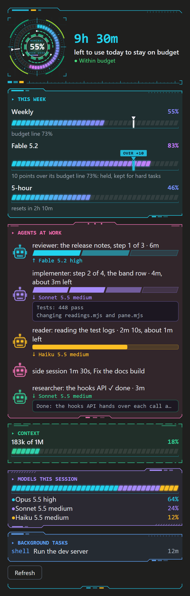
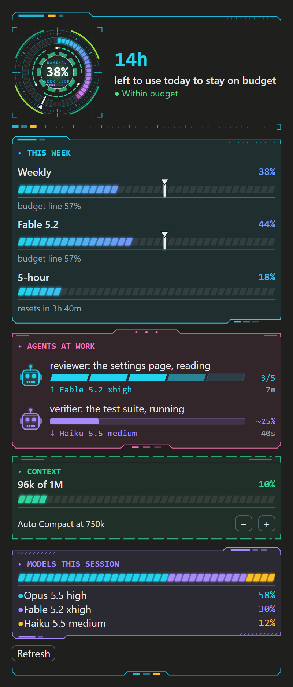
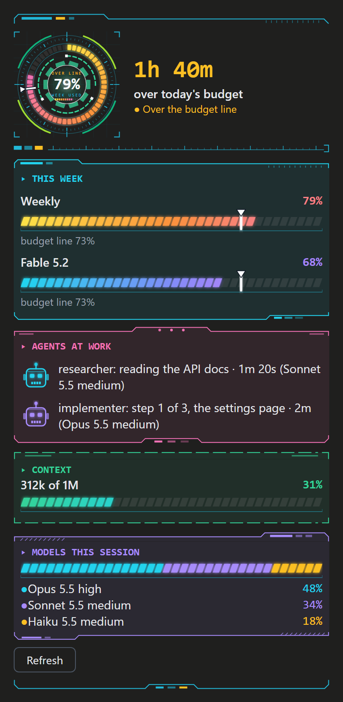

# claude-pacing

**Pacing** is a plugin for Claude Code. Claude plans have a weekly usage
limit. Pacing lets you use better models and still make the week last:
your best model does the hard work, and easier work goes to subagents on
cheaper models. A day-by-day budget decides how much moves down. While you
are under it, nearly everything stays on the best model; the further over
it you go, the more goes to the cheaper ones, so the week doesn't run out
before the reset. You choose how many tiers there are, and the model and
effort of each.

<p>



</p>

The pacing pane, with sample figures.

## Who it is for

Anyone who uses Claude Code on a Claude plan with weekly usage limits and
runs into them, or wants a stronger model without running out. It does
most in the Claude desktop app, where it reads every usage meter by
itself and shows the pane. In a plain terminal session it has the weekly
meter and the 5-hour window, and carries the per-model figure over from
the last full reading.

It needs Node.js 18 or later on the PATH of the shell Claude Code uses.

## What you will see after installing

- **A status line** under the prompt after every turn, such as
  `Budget: 2h 10m left · usage: Weekly 36% Fable 40%`: how long what
  today's budget still allows will last at your pace, then the weekly
  meters.
- **A pane beside the chat** in the desktop app (the pictures above): the
  week as a dial, the meters, the agents at work with a bar for their
  steps and a box of their main tasks, the session's context.
- **Short messages.** A toast when the budget gets far over its line or
  the week is nearly used, and now and then a row above the prompt that
  offers to compact a large session or, when Fable is out or far over its
  line, to switch model. Nothing is compacted or switched without your
  click.
- **Work handed to subagents.** Claude says in one line which agent it
  started, on which model, and for what, and gives you the result in the
  same session. Independent parts of a task go to several agents at once,
  so the work is done sooner.
- **Two settings written for you.** After a reading you ask for, the
  recommended model and effort for *new* sessions go into
  `~/.claude/settings.json` (on Windows also into the desktop app's
  default for new local sessions). `/pacing next off` turns that off.
  Everything else the plugin keeps is in `~/.claude/pacing`.

The plugin lives in [`pacing/`](pacing/); its [README](pacing/README.md)
has the details, its [GUIDE](pacing/skills/pacing/GUIDE.md) the rules.

## What it does

- **Tiers of models.** By default Fable 5.2 high runs the session, and
  Opus 5.5 medium and Sonnet 5.5 medium take work as subagents. While
  Fable's own meter is used up, Opus 5.5 high takes the top place.
  The number of tiers and each tier's model and effort are yours to set.
- **A budget line for every day.** The weekly meter is compared with a
  budget line that steps up at midnight. Ahead of it, the top model does nearly
  everything; past it, more work moves down the tiers. The logged trend
  can raise the level before the meter gets there. Fable's meter is
  paced on the same budget line while Fable runs the session, so a long session
  cannot drain it unseen.
- **A status line after every turn:**

  ```
  Budget: 2h 10m left · usage: Weekly 36% Fable 40%
  ```

  What is left under today's budget line, as the time it lasts at your
  pace (`Budget: 40m over` past the line), then the weekly meters. While
  subagents run, their count comes first (`⏳ 2 Subagents running`).
  `/pacing-status` gives it in words, with how this session's use splits
  over the models and what fills the session's context.
- **A pacing pane**, open beside the chat from the session's start and
  drawn as a ship's console: a reactor dial for the week, the time left
  today to stay on budget, the meters, the agents at work as small
  robots with their model, a bold bar of their steps and a box of their main
  tasks, the context and the models (`/pacing-pane` reopens it). Past
  its budget line, Fable's own meter gets an `OVER` tag; on every bar
  the stretch over the line blends to yellow by 5 points over, then
  orange and red the further over (Fable's meter is yellow only at 20
  points over, red from 80); the context bar turns from green to red
  past 300k tokens. The pane comes from readings the plugin
  takes by itself after a turn, on a Claude Code version with hooks
  modules; older versions run the rest of the plugin as before. The
  pictures at the top are drawn by the pane's own code with sample
  figures (`node scripts/pane-images.mjs` makes them again); the desktop
  app's type and spacing differ a little.
- **Role agents the session keeps.** A reader (Haiku 5.5 by default) for
  logs, searches and unfamiliar code, a verifier for tests and checks, an
  implementer for specified edits, and a researcher for documentation.
  Each leaves notes per project for the next agent of its role. Several
  run at once on independent parts of a task, so it is done sooner; never
  two on the same files, and the session gives you the combined result.
- **A long session kept affordable.** From 400 000 tokens a row offers
  to compact it; a handover is written only when a new session is the only way.
- **A start line in every new session** with the last reading. It asks
  you to switch model only when Fable is out until the reset.
- **A switch that knows what it costs.** In a large session the Switch row
  offers **Compact, then switch**, since a new model stores it all again.
- **Room left over.** The pane and `/pacing-status` say when the week
  would end with allowance unused: it does not carry over.
- **Weekly summaries** with `/pacing week`.

## Install

This repository is a Claude Code plugin marketplace with one plugin. In a
Claude Code session:

```
/plugin marketplace add Zebetite/claude-pacing
/plugin install pacing@claude-pacing
```

Then type `/pacing:pacing`. The first run creates `~/.claude/pacing` with
the default ladder and shows the guide; `/pacing:pacing setup` changes the
ladder, and the top tier is picked once in the session's model menu.

Updates: turn on auto-update for this marketplace under `/plugin` →
Marketplaces (it is off by default for marketplaces you add yourself), or
run `/plugin marketplace update claude-pacing` and `claude plugin update
pacing@claude-pacing`. A running session then shows a row above the prompt
that says to type `/reload-plugins` or open a new session, with **Not now**
(`/pacing reload off` puts a one-line toast in its place).

The plugin reads the weekly meters on your plan's usage card. If the card
has no meter for one model (no "Weekly · Fable" or similar line), run
`/pacing:pacing premium none` once.

## Tests

`npm test` (or `node --test tests/*.test.mjs`) in this folder runs the
tests in `tests/`.
They need nothing installed. Each script runs in a child process whose
home folder is a new temp folder, so the tests never read or change your
own `~/.claude`. The `tests/` folder is outside the plugin and is not
published with it.

The hooks module for automatic readings has its own test, which runs
under Claude Code's test kit: `claude plugin test pacing`.

## Releases

Each release is a commit that bumps `version` in
`pacing/.claude-plugin/plugin.json`; the marketplace entry carries no
version of its own, so that number is the one users see.

## Licence

MIT, see [LICENSE](LICENSE).
