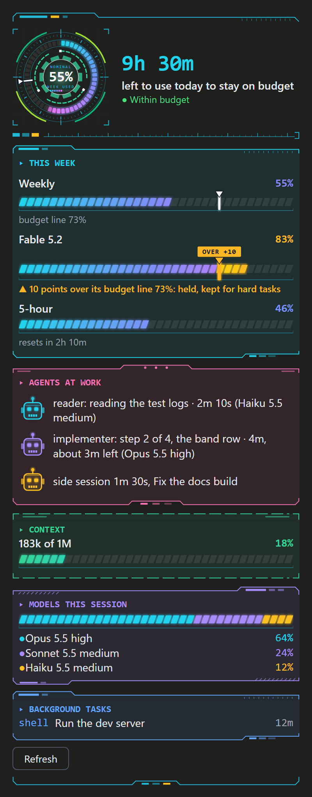
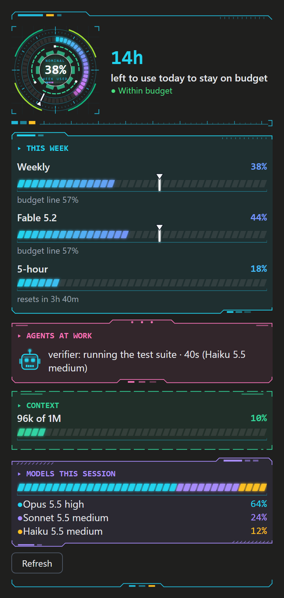
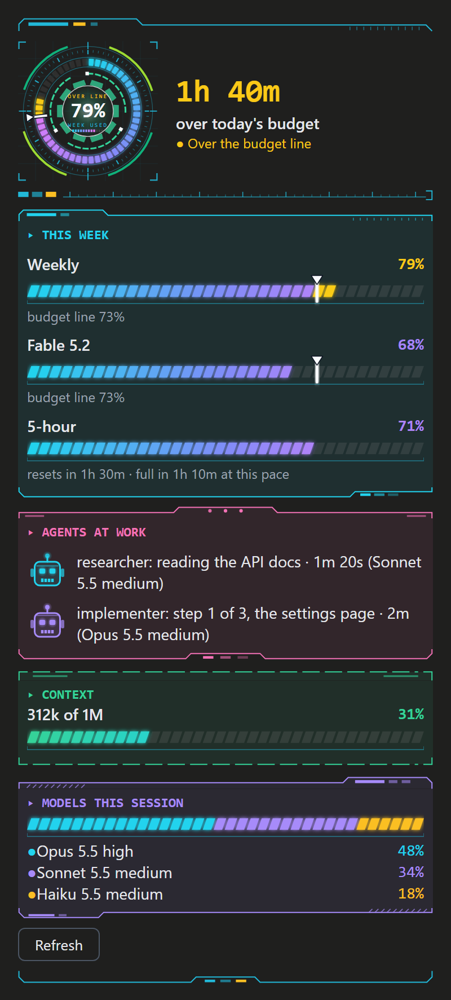

# pacing — a Claude Code plugin that paces the weekly allowance

Claude plans have a weekly usage limit. Pacing lets you use better models
and still make the week last: your best model does the hard work, and
easier work goes to subagents on cheaper models. A day-by-day budget
decides how much moves down. While you are under it, nearly everything
stays on the best model; the further over it you go, the more goes to the
cheaper ones, so the week doesn't run out before the reset. You choose how
many tiers there are, and the model and effort of each.

**Who it is for:** anyone who uses Claude Code on a Claude plan with
weekly usage limits. It does most in the Claude desktop app, where it
reads every usage meter by itself and shows a pane beside the chat; a
plain terminal session has the weekly meter and the 5-hour window. It
needs Node.js 18 or later.

**What you will see after installing:**

- a status line under the prompt after every turn, such as
  `Budget: 2h 10m left · usage: Weekly 36% Fable 40%`: how long what
  today's budget still allows will last at your pace, then the weekly
  meters;
- the pacing pane beside the chat, in the desktop app;
- a toast when the budget gets far over its line or the week is nearly
  used, and now and then a row above the prompt that offers to compact a
  large session or, when Fable is out or far over its line, to switch
  model (nothing is compacted or switched without your click);
- one line from Claude when it hands work to a subagent, saying which
  agent, which model and what for, and the result in the same session;
  independent parts of a task go to several agents at once, so the work
  is done sooner;
- two settings written for you: after a reading you ask for, the
  recommended model and effort for *new* sessions go into
  `~/.claude/settings.json` (on Windows also into the desktop app's
  default for new local sessions). `/pacing next off` turns that off.

The default tiers are Fable 5.2 high for the session, Opus 5.5 medium and
Sonnet 5.5 medium for subagents; while Fable's own meter is used up, Opus
5.5 high takes the top place. The budget line is drawn against the weekly
meter ("Weekly · all models"), and against Fable's meter while Fable
runs the session. `skills/pacing/GUIDE.md` explains the
rules; `skills/pacing/SKILL.md` (reports and settings) and
`skills/route/SKILL.md` (delegating work) are what Claude follows.

## The pacing pane

Open beside the chat from the session's start (`/pacing-pane` reopens
it): the week as a dial, the time left today to stay on budget, the
meters, the agents at work, the context and the models. Sample figures
(on the organization library's page, open them under `images/` in the
file list: the page shows a README's pictures as their descriptions):







## What is in the plugin

| path | what |
|---|---|
| `.claude-plugin/plugin.json` | the manifest: name `pacing`, the version |
| `skills/pacing/SKILL.md` | the skill for reports and settings, invoked as `/pacing:pacing` (or by typing "usage") |
| `skills/route/SKILL.md` | the rules for delegating work, which Claude loads once per session before its first delegation (`/pacing:route`) |
| `skills/pacing/GUIDE.md`, `BRIEF.md` | the user guide, and the standing brief for subagents, which `config.mjs start` prints for each agent with its notes and the user's own rules |
| `skills/pacing/INTERNALS.md` | how it works inside: the automatic readings in detail, how the budget in tokens is learned, when a report reuses the last reading, how `/pacing-status` splits use by model, how a new version is found. Nothing loads it automatically |
| `skills/pacing/SETUP.md`, `HANDOVER.md` | the steps for `setup` and for writing a handover, read only when needed so that `SKILL.md` stays short |
| `agents/*.md` | the four role agents the session delegates to and keeps for its whole run: `reader`, `verifier`, `implementer`, `researcher` |
| `skills/pacing/scripts/*.mjs` | `budget.mjs` (the rule), `config.mjs` (the ladder), `hook.mjs` (session start), `models.mjs` (the model table), `line.mjs` (the budget line, the pace and the trends, without files), `paths.mjs` (every path: Claude Code's folder, the data folder, a project's notes and handovers, the desktop app's files), `safe.mjs` (writes that several sessions can make at once without losing one), `doctor.mjs` (the self-check: is pacing working here, and what to do if not), `saved.mjs` (what handing work to agents on cheaper models saved this week), `estimate.mjs` (what this week's local sessions cost, from their transcripts: the first "Budget tokens" figure before the rate is learned) |
| `hooks/hooks.json` | a SessionStart hook that shows the last reading and the recommended model, and says when another session has been at work in the project; a SessionEnd hook that takes this session's mark off the project |
| `hooks/readings.json`, `readings.mjs` | automatic readings after a turn, a status line with what is left of the budget and the weekly meters' usage (both always whole) and how many subagents run (that part shrinks to keep the line within 70 characters in the desktop app), the reports `/pacing-status`, `/pacing-usage`, `/pacing-doctor` and `/pacing-saved` without a model call, and a toast when a large session resumes after an hour's pause, through a hooks module, on a Claude Code version that has them; an older one reads the file's empty `hooks` block and skips the module. `readings.test.ts` tests it (`claude plugin test`) |

The scripts run with `node` (Node.js 18 or later), which must be on the
PATH of the shell Claude Code uses.

## Install

From the marketplace this plugin is published in:

```
/plugin marketplace add Zebetite/claude-pacing
/plugin install pacing@claude-pacing
```

From an organisation's plugin library on claude.ai: Claude Code sessions
signed in with the claude.ai account pick the plugin up at start (it shows
as `pacing@synced` under `/plugin` → Installed); new versions arrive the
same way, and a running session says so in a row above the prompt: type
`/reload-plugins` or open a new session (`/pacing reload off` puts a toast in its place). To try a local copy for one
session: `claude --plugin-dir <this folder>`.

Then, in a session, type `/pacing:pacing`. The first run creates the data
folder, shows the guide once, and takes over the files of an earlier
standalone install of this skill (`~/.claude/skills/pacing`) if there is
one. Run `/pacing:pacing setup` to confirm or change the ladder, then pick
the top tier in the session's model menu (the skill cannot switch a
running session's model). On a plan whose usage card has no per-model
meter (no "Weekly · Fable" or similar line), run `/pacing:pacing
premium none` once; on a plan that meters another model, name it
(`premium opus`).

## What is written where

Everything the user owns lives in `~/.claude/pacing`, outside the plugin
folder, which an update replaces:

| file | what |
|---|---|
| `config.json` | the ladder, the last-day weight, the per-model meter and its fallback, the reader's model, the next-session switch and the other settings (`compact`, `notify`, `switch`, `reload`, `autocompact`) |
| `log.jsonl`, `state.json` | the readings, and the last one for the hook |
| `line.json` | the newest reading's account-wide part (meters, budget line, what is left, the rate), which every session's status line takes in |
| `rate.json`, `scan.json` | what a point of the weekly meter costs, as learned from the week's sessions, and where the last pass over each session's transcript left off, so the next one reads only what was added |
| `BRIEF.local.md` | the user's own rules for subagents (never part of the plugin) |
| `notes/<project>/<role>.md` | what each role agent learned about a project, a line per fact, for the next agent of that role |
| `agents/<project>.jsonl` | each task a role agent finished: role, agent id, model, effort, tokens |
| `handover/<project>/*.md` | what a long session left for the next one; those picked up are kept in `done/` |

With the next-session switch on, the skill also writes the recommended
model into `~/.claude/settings.json` (`model`, `effortLevel`) and, on
Windows, into the desktop app's built-in preset for new local sessions.
On macOS and Linux the preset is not touched; the session start line says
when to change the model menu by hand.

## Coming from the standalone skill

If `~/.claude/skills/pacing` is still installed next to the plugin, both
load (`/pacing` and `/pacing:pacing`) and two session-start hooks fire.
Once the plugin works, take the old hook out: in `~/.claude/settings.json`,
remove the `SessionStart` entry that mentions `skills/pacing` (an old copy
that has the command does it with `node
~/.claude/skills/pacing/scripts/config.mjs hook off`). Then delete that
folder.

## Remove

Remove the plugin in `/plugin`; delete `~/.claude/pacing` if the readings
and the local brief are not wanted either.

## Licence

MIT, see [LICENSE](LICENSE).
